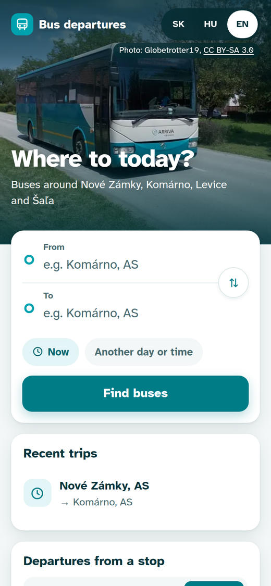
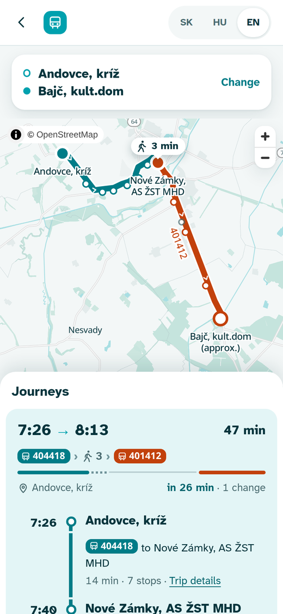
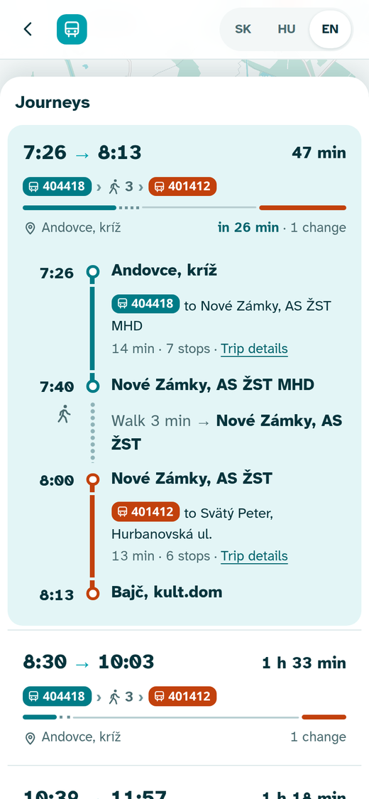
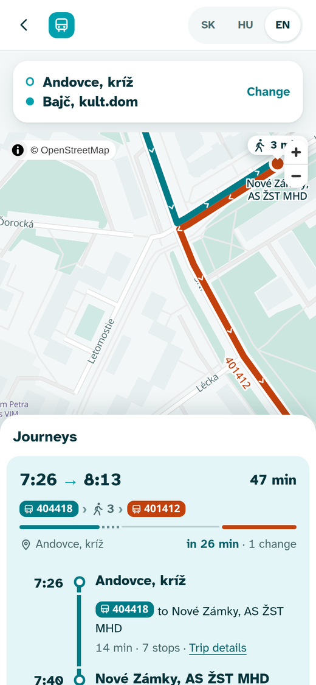
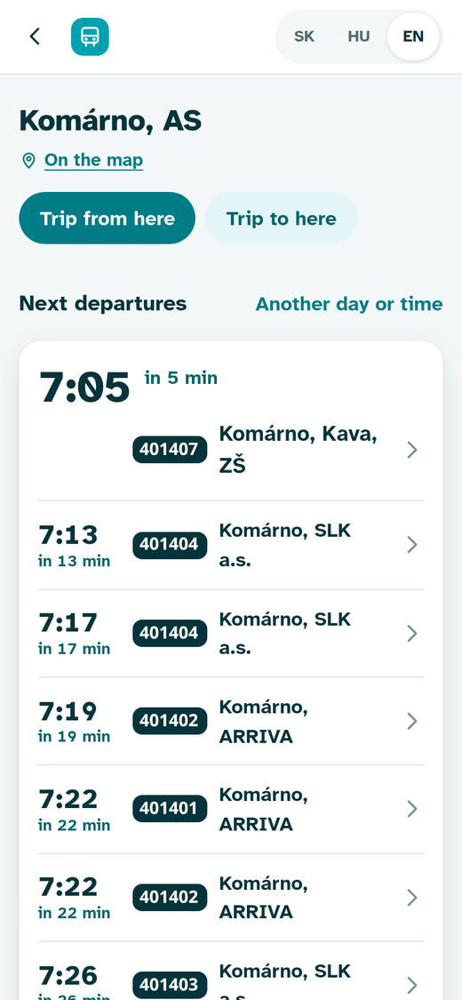
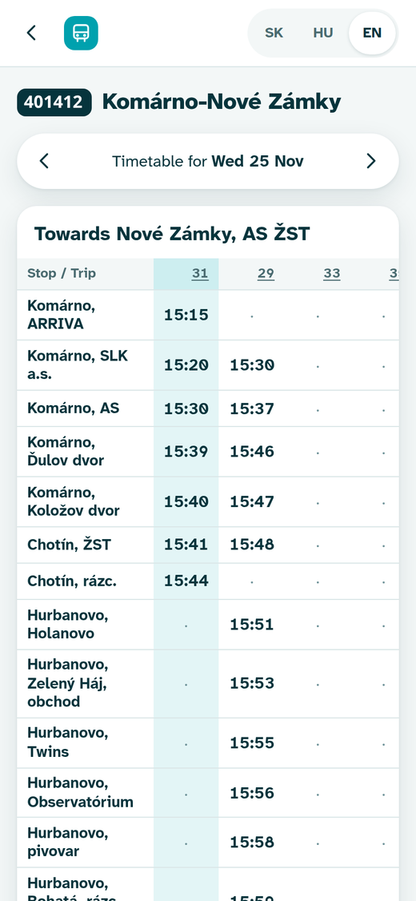
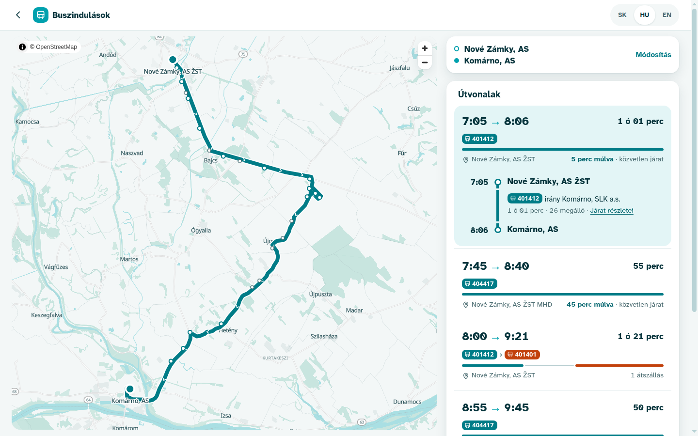
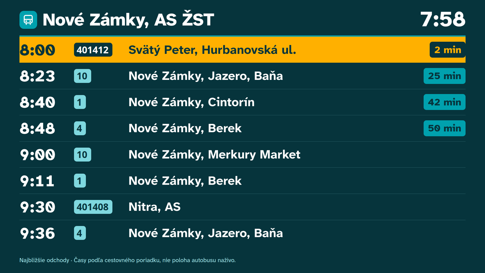

# Tyrkobus

**Open bus timetables, a journey planner and stop departure boards for the
Arriva Nové Zámky regional buses (Nitra region, Slovakia).**

Arriva publishes its timetables only as PDF files. Tyrkobus reads those PDFs,
turns them into an open [GTFS](https://gtfs.org/) timetable feed, and serves a
web app for phones and a full-screen departure board for TVs on top of it. It
checks for new timetables twice a day and renews itself.

> **Not an official Arriva app.** Times come from Arriva's public timetables
> and are not live bus positions. Always check [arriva.sk](https://arriva.sk/nove-zamky/).

> [!WARNING]
> **This project is not finished.** The biggest gap is the **positions of the
> bus stops**. See [What is missing](#what-is-missing) before relying on the map
> or walking directions.

## Screenshots

| Plan a trip | Journeys on the map | Journey details |
|---|---|---|
|  |  |  |

| Arrows show which way each bus drives | Departures from a stop | Line timetable |
|---|---|---|
|  |  |  |

**Desktop** (Hungarian):



**Departure board for a TV** at a bus station. The bus leaving within two
minutes turns amber; when it leaves, it slides off and the rest move up:



## What it does

- **Timetables from PDFs.** Reads all 116 Arriva Nové Zámky timetable PDFs
  (114 lines, about 2,800 trips), including footnotes like "runs on school
  days" and holidays, into GTFS. Nothing is guessed: a trip the parser
  can't read with certainty is left out and reported.
- **Renews itself.** `pdf2gtfs update` finds and downloads new PDFs from
  arriva.sk; `pdf2gtfs build` publishes a new feed **only if it passes
  checks** (no sudden loss of trips or lines, enough days covered, …),
  otherwise the last good feed stays live. `pdf2gtfs rollback` swaps back.
- **Journey planner.** Up to four buses, changes between platforms of a bus
  station, and short walks between nearby stops along real footpaths and
  streets. Says the day when the next bus is tomorrow.
- **Offline map.** Self-hosted map tiles (no Google, no tracking). Buses are
  drawn along the roads they drive, with arrows showing the direction, so a
  change to a bus going the other way is clear at a glance.
- **Stop pages and line timetables**, with the next bus first.
- **TV departure board** (`/board/<stop>`) that runs for weeks: it keeps
  the right time even if the TV's clock is wrong, shows an offline note if
  the network drops, and refreshes itself.
- **Slovak, Hungarian and English.** Works without JavaScript (the map and
  animations need it). Recent trips are stored only on your own device.

## What is missing

### Real positions of the bus stops

Arriva's PDFs contain **stop names only, no coordinates**. Tyrkobus matches the
names to bus stops mapped in [OpenStreetMap](https://www.openstreetmap.org/).
Of **1,380 stops, 768 are found in OpenStreetMap. The other 612 (44 %) are
approximate.** Each one sits at the village centre or at an estimated point
on the road the bus drives. The app marks them "(approx.)", but this means:

- a stop on the map can be **hundreds of metres from the real pole**;
- walking between stops is only offered where **both** positions are known,
  so some good changes on foot are missing;
- stops on opposite sides of the road (one for each direction) are not told
  apart yet.

There is no open register of regional bus stop positions in Slovakia. The ways
to fix this legally are:

1. **Map the stops in OpenStreetMap**, for example with
   [StreetComplete](https://streetcomplete.app/) or the OSM editor while
   standing at the stop. Every stop added there is picked up by the next build.
2. **Ask the Nitra Self-Governing Region** (Nitriansky samosprávny kraj, which
   orders the bus service) for the stop register, under the Slovak Freedom of
   Information Act (zákon č. 211/2000 Z. z.).

Positions are **not** copied from Google Maps or other apps: their terms
forbid it, and OpenStreetMap doesn't accept such data.

### Also not done yet

- Live bus positions and delays (Arriva publishes none openly).
- Android and iPhone apps (the web app works on phones today).
- Other operators and regions.

## Run it

You need [Rust](https://rustup.rs/) (stable; tested with 1.100) and
`pdftotext` from poppler (package `poppler-utils` on Debian, Ubuntu and Fedora).

```sh
cargo build --release

# 1. Download the timetable PDFs from arriva.sk (into data/archive/)
./target/release/pdf2gtfs update

# 2. Walking paths (optional; stops.json and roads.bin are already in the repo)
curl -L -o data/osm/slovakia-latest.osm.pbf https://download.geofabrik.de/europe/slovakia-latest.osm.pbf
./target/release/pdf2gtfs osm-extract data/osm/slovakia-latest.osm.pbf

# 3. Build the GTFS feed (data/gtfs/feed and data/gtfs/gtfs.zip)
./target/release/pdf2gtfs build

# 4. Map tiles for the region (optional; without them the routes are drawn on a blank background)
#    pmtiles CLI: https://github.com/protomaps/go-pmtiles/releases
#    builds list: https://build-metadata.protomaps.dev/builds.json
pmtiles extract https://build.protomaps.com/<YYYYMMDD>.pmtiles data/map/region.pmtiles \
  --bbox=17.40,47.70,19.20,48.60 --maxzoom=14

# 5. Start the web app at http://127.0.0.1:8080
./target/release/web
```

Useful pages: `/stop/komarno-as`, `/line/401412`,
`/board/nove-zamky-as-zst` (TV board; press F11). Add `?now=2026-11-25T07:00`
to any page to see it at another time.

`cargo test` runs the tests (about 190). To check the feed with the official
validator: `podman run --rm -v "$PWD/data/gtfs":/work:Z
ghcr.io/mobilitydata/gtfs-validator:latest -i /work/gtfs.zip -o /work/validation`.

### Automatic updates

`deploy/systemd/` has a user timer that runs `update` and `build` at about
06:00 and 18:00 (and after the PC was off). It expects the project in
`~/tyrkobus`; edit the paths in the `.service` file if it lives elsewhere.

```sh
ln -sf "$PWD"/deploy/systemd/pdf2gtfs-update.{service,timer} ~/.config/systemd/user/
systemctl --user daemon-reload && systemctl --user enable --now pdf2gtfs-update.timer
```

## How it is built

| Part | What it does |
|---|---|
| `crates/pdf2gtfs` | Downloads the PDFs, decodes their timetable font, rebuilds each timetable grid, reads the footnotes into running dates, places stops using OpenStreetMap, draws each trip along the roads, writes and checks the GTFS feed. |
| `crates/planner` | The journey planner (no network or files: runs on a server or in an app). |
| `crates/web` | The web app and TV board (Rust, server-rendered HTML; JavaScript only for the map and small extras). |
| `data/osm/` | Bus stops, places and roads extracted from OpenStreetMap. |
| `scripts/audit.py` | Checks every dependency against known vulnerabilities (OSV) and the vendored files against their recorded checksums. |

## Data and licences

- **Code:** MIT, see [LICENSE](LICENSE).
- **Map data and `data/osm/`:** © [OpenStreetMap contributors](https://www.openstreetmap.org/copyright), ODbL.
  Map tiles from [Protomaps](https://protomaps.com/).
- **Timetables:** from Arriva Nové Zámky's public PDFs. The generated feed is
  not stored in this repository. Three timetable PDFs are kept in
  `crates/pdf2gtfs/tests/fixtures/` only to test the parser.
- **Bus photo:** Irisbus Crossway in Salka by Globetrotter19,
  [CC BY-SA 3.0](https://commons.wikimedia.org/wiki/File:Irisbus_Crossway_nach_Sturovo,_2023_Salka.jpg);
  the cropped versions are shared under the same licence
  (`crates/web/assets/img/SOURCES.md`).
- **Fonts:** Atkinson Hyperlegible Next and Noto Sans, SIL Open Font License 1.1.
- **Map library:** MapLibre GL JS, pmtiles and Protomaps basemaps (BSD-3-Clause),
  map icons (MIT). Versions and checksums: `crates/web/assets/vendor/VENDOR.md`.

## Help wanted

The most useful help is **mapping bus stops in OpenStreetMap** around Nové
Zámky, Komárno, Levice and Šaľa. Issues and pull requests are welcome.
